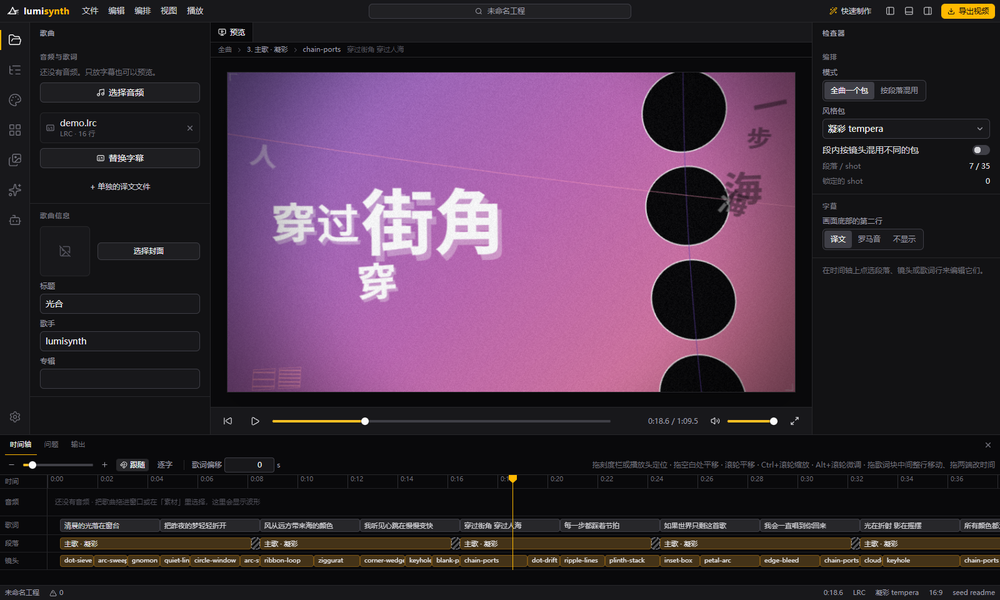
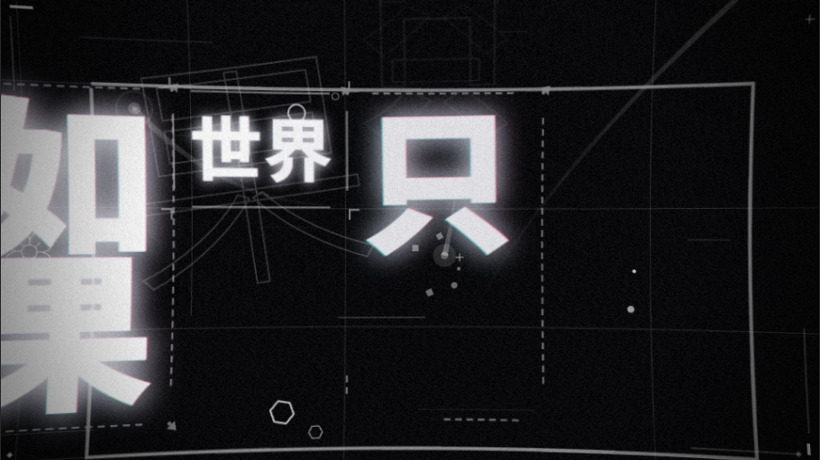
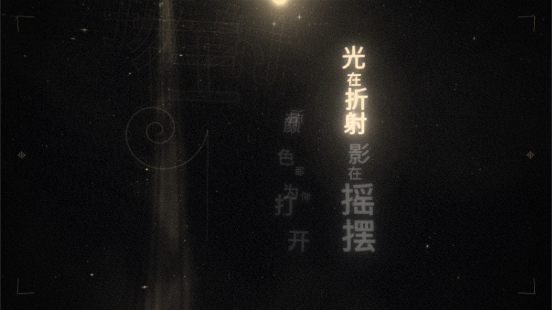

# lumisynth 光合

**简体中文** | [English](README.en.md)

在浏览器里把一首歌做成歌词 PV：导入音频和字幕，自动编排镜头，按需微调，导出视频。

**在线使用：<https://lumisynth.cielaniska.top/>**

[](https://workers.cloudflare.com/)



## 主要功能

- **自动编排**：读入歌词后自动分段、分镜，每个镜头从风格包的预设里挑选，开箱就能看。
- **四套风格包**：凝彩、商籁、绘光、花火，可以全曲用一套，也可以按段落混用。
- **手动调整**：时间轴上直接改段落、镜头、转场和歌词时间；每个镜头都能换风格、锁定、加组件。
- **字幕格式**：LRC / YRC / QRC / KRC / TTML / VTT / SRT / ASS 等，支持译文与罗马音。
- **素材与背景**：图片、视频素材可以叠在画面里，也可以作背景轨。
- **导出视频**：MP4 / WebM 逐帧渲染，最高 4K；也可以分层导出透明图层。
- **AI（可选）**：用自己的密钥生成主题配色、分词与编排；不配置也能完全用本地规则。
- **接入 agent**：支持 MCP，Claude Code 等 agent 可以直接读取和修改正在编辑的工程。
- **工程保存在本地**：存在浏览器（或桌面版的本机目录）里，可导出 / 导入 `.lumi` 工程包。

## 风格包

| 凝彩 tempera | 商籁 sonnet |
|---|---|
|  |  |
| 网点与几何图形的 MG 动画 | 排字运动，线框与版式 |
| **绘光 lumiere** | **花火 hanabi** |
|  |  |
| 暗场里的体积光、烟雾与光刻字 | 日式歌词 PV：色块字、烟花装饰、持续上升 |

想自己写一套风格包，见 [docs/PACKS.md](docs/PACKS.md)。

## 开始使用

- **网页版**：打开 <https://lumisynth.cielaniska.top/> 即可，无需安装。
- **桌面版**：Windows / macOS / Linux 安装包在 [Releases](../../releases) 下载，离线也能编辑与导出，见 [docs/DESKTOP.md](docs/DESKTOP.md)。

基本流程：选择音频 → 导入字幕 → 预览自动编排的结果 → 在时间轴上调整 → 导出视频。

## AI 与 agent

AI 是可选的。在「AI」侧栏选择提供方（Google Gemini、OpenAI 兼容接口、Anthropic Claude）并填入自己的密钥；请求从浏览器直接发给提供方，密钥只保存在本机浏览器里。

要让 agent 来编排：在「Agent」面板下载本地桥 `lumisynth-mcp.mjs`，添加到 agent（如 `claude mcp add lumisynth -- node /path/to/lumisynth-mcp.mjs`），再按面板提示配对连接。剧本语言与 agent 用法见 [docs/SCRIPT.md](docs/SCRIPT.md)。

## 部署

构建产物 `dist/` 是纯静态文件，任何静态托管都可以（找不到的路径回退到 `index.html`）。仓库已带好 Cloudflare Workers（`npm run cf:deploy`）与 Vercel（直接导入仓库）的配置。

点下面的按钮可以一键部署到自己的 Cloudflare 账号：

[](https://deploy.workers.cloudflare.com/?url=https://github.com/chthollyphile/lumisynth)

## 开发

```bash
npm install
npm run dev          # 开发服务器
npm test             # 单元测试
npm run build        # 构建网页版
npm run dev:electron # 桌面版开发
```

## 许可

Copyright © 2023–2026 chthollyphile.
Licensed under the GNU Affero General Public License v3.0 only. 见 [LICENSE](LICENSE)。

风格包与字幕处理代码移植自 folia（同为 AGPL-3.0）。
